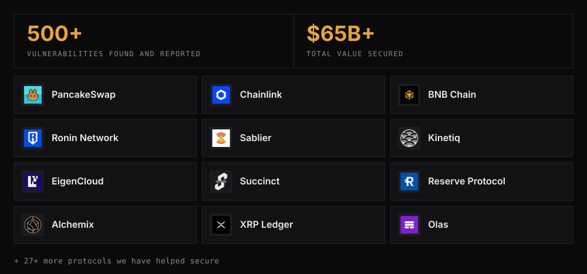

# We find what others miss

[Parapet Labs](https://parapetlabs.net) is a Web3 security firm. Through expert-led research and AI-assisted analysis, we help complex DeFi and Web3 protocols uncover critical vulnerabilities before attackers do.

We audit **EVM** and **Solana** smart contracts: manual review, AI scanning, fuzzing, protocol design review and formal verification. Every report comes with severity-ranked findings and recommended fixes, every fix is re-checked, and you get a one-month bounty window after the final report.

Read our published work in **[public-Audits](https://github.com/parapetlabs/public-Audits)**.

 

# Contact us

&nbsp;
&nbsp;
&nbsp;
&nbsp;
&nbsp;
&nbsp;
&nbsp;

